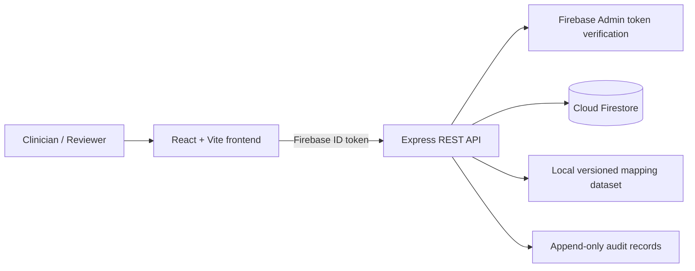

# AYUSH EMR Bridge

AYUSH EMR Bridge is a basic prototype that brings Modern Medicine and AYUSH patient records into one place. It helps users view patient history and check possible terminology mappings between ICD-11 and NAMASTE concepts.

Live Demo- https://ayush-emr-bridge.vercel.app/

Credentials :
Email - shravani@demo.com
Password - 123456

## Architecture


## Features

- Login using Firebase Authentication.
- Register and search fictional patients.
- Add Modern Medicine and AYUSH encounters.
- View patient history in one place.
- Search terminology mappings.
- Review and approve/reject mapping suggestions.
- Keep basic audit records.
- Show mapping status when a match is uncertain or unavailable.

## Tech Stack

- **Frontend:** React, Vite
- **Backend:** Node.js, Express
- **Database:** Firebase Firestore
- **Authentication:** Firebase Authentication
- **Deployment:** Vercel and Render

## How It Works

1. Login to the application.
2. Register a fictional patient.
3. Add encounters from Modern Medicine or AYUSH.
4. View the patient's combined history.
5. Search and review possible terminology mappings.

## Run Locally

Backend:

```bash
cd backend
npm install
npm run dev
```

Frontend (open another terminal):

```bash
cd frontend
npm install
npm run dev
```

Add the required environment variables and Firebase credentials before running the application. See `.env.example` files for the required configuration.

## Testing

Run backend tests:

```bash
cd backend
npm test
```

## Important Note

This is a prototype made for demonstration using fictional records and sample mapping data. It does not connect to real hospitals or implement ABHA/ABDM or FHIR integration. The sample mappings are not official clinical equivalences and must not be used for medical decisions.
