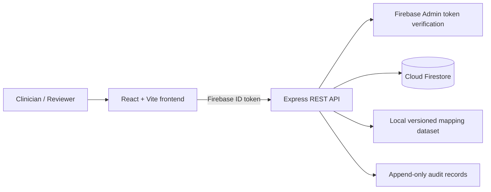

# AYUSH EMR Bridge

A demo middleware MVP that presents fictional Modern Medicine and AYUSH encounters in one patient history, with a cautious terminology-mapping workflow.

> **Prototype notice:** This project is for demonstration and software-development learning only. It is not a clinical decision-support system, not certified for clinical use, and must not be used with real patient data. The included terminology rows are synthetic examples, not official ICD-11 or NAMASTE codes or mappings.

## Architecture



## MVP features

- Firebase Email/Password sign-in and protected frontend routes.
- Backend verifies Firebase ID tokens and checks server-side custom claims / user role.
- Patient registration and search.
- Separate Modern Medicine and AYUSH encounters.
- Unified chronological patient history.
- Terminology lookup with explicit `DEMO_UNVERIFIED`, `RELATED_REVIEW`, `NO_MAPPING`, and `VERIFIED_EXACT` statuses.
- Mapping-review workflow restricted to `admin` and `clinician` roles (approval must not be interpreted as clinical validation unless supported by authoritative evidence).
- Basic audit events.
- Health endpoint, validation, consistent errors, CORS configuration, and tests.

## Not implemented / not claimed

- No hospital/EMR connection.
- No ABHA or ABDM integration.
- No FHIR implementation.
- No configured WHO ICD-11 API connection by default.
- No authoritative NAMASTE dataset bundled.
- No production clinical equivalence mapping.
- No claim of legal compliance, certification, or clinical validation.

## Requirements

- Node.js LTS and npm
- Git
- Firebase project with Email/Password Authentication and Firestore enabled
- Firebase Admin credentials for the backend

## 1. Install dependencies

From the repository root, open two terminals:

```powershell
cd backend
npm install
Copy-Item .env.example .env
```

In a second terminal:

```powershell
cd frontend
npm install
Copy-Item .env.example .env
```

Edit both `.env` files using the setup instructions below. Never commit them.

## 2. Firebase setup

1. Open https://console.firebase.google.com/ and create a project.
2. In **Build → Authentication → Sign-in method**, enable **Email/Password**.
3. In **Build → Firestore Database**, create a database. For a demo, choose a location suitable for your users and follow Firebase's current setup guidance.
4. In **Project settings → General**, register a Web app and copy its web config values into `frontend/.env`.
5. In **Project settings → Service accounts**, generate a private key only if needed for local development. Keep the downloaded JSON outside the repository. Never commit it.
6. Set `GOOGLE_APPLICATION_CREDENTIALS` in `backend/.env` to the absolute path of that JSON file. For example, `C:\Users\YOUR_USER\secure\firebase-admin.json`.
7. In Firestore Rules, use the restrictive rules in `docs/firestore.rules`. Because all patient-data operations go through the backend Admin SDK, browser SDK direct access to patient collections is denied. Firebase Admin bypasses Firestore rules, so API authorization is essential.
8. Create the first user in Authentication. Then assign a role using the secure one-time script described in `docs/SETUP.md`. Never trust a role submitted by the browser.

### Firebase environment variables

`frontend/.env` (values from your Firebase web app):
```env
VITE_FIREBASE_API_KEY=your-web-api-key
VITE_FIREBASE_AUTH_DOMAIN=your-project.firebaseapp.com
VITE_FIREBASE_PROJECT_ID=your-project-id
VITE_FIREBASE_APP_ID=your-web-app-id
VITE_API_BASE_URL=http://localhost:4000
```

`backend/.env`:
```env
PORT=4000
NODE_ENV=development
FRONTEND_ORIGIN=http://localhost:5173
FIREBASE_PROJECT_ID=your-project-id
GOOGLE_APPLICATION_CREDENTIALS=C:\absolute\path\to\firebase-admin.json
```

Firebase web configuration is intended to identify the client project, not to authorize access by itself. Admin credentials are privileged secrets and must never be placed in Vite variables or frontend files.

## 3. Assign a role to the first user

After creating the user in Firebase Authentication, copy their UID from the Authentication users list. From `backend/`, set the required environment variables, then run:

```powershell
npm run set-role -- --uid YOUR_FIREBASE_UID --role admin
```

This script requires `GOOGLE_APPLICATION_CREDENTIALS` and `FIREBASE_PROJECT_ID`. It sets a Firebase custom claim. Sign out and sign back in after changing claims so the refreshed ID token contains the new role.

The backend also supports a Firestore `users/{uid}` role record for operational role lookup. The custom claim takes precedence. Only a trusted administrator should assign roles.

## 4. Start the app

Terminal 1:
```powershell
cd backend
npm run dev
```

Check `http://localhost:4000/api/health`. Expected response includes `"ok": true`.

Terminal 2:
```powershell
cd frontend
npm run dev
```

Open the URL printed by Vite, usually `http://localhost:5173`.

Create/sign in with the Firebase user you configured. Without valid Firebase config and backend credentials, protected API operations will fail by design.

## 5. Demo data

After setting up Firebase and assigning an admin role:
```powershell
cd backend
npm run seed
```

The script creates fictional records in Firestore. It is safe to run more than once because it uses stable demo IDs. Do not seed real data.

## 6. API overview

All routes except `GET /api/health` require `Authorization: Bearer <Firebase-ID-token>`.

| Method | Route | Role | Purpose |
|---|---|---|---|
| GET | `/api/health` | Public | Health check |
| GET | `/api/dashboard` | viewer+ | Counts from Firestore |
| GET | `/api/patients?q=...` | viewer+ | Search patients |
| POST | `/api/patients` | clinician/admin | Register patient |
| GET | `/api/patients/:patientId` | viewer+ | Patient details |
| GET | `/api/patients/:patientId/history` | viewer+ | Combined encounter history |
| POST | `/api/patients/:patientId/encounters` | clinician/admin | Add encounter |
| GET | `/api/mappings/search?q=...` | viewer+ | Search mapping dataset |
| GET | `/api/reviews` | clinician/admin | List review items |
| POST | `/api/reviews/:reviewId/decision` | clinician/admin | Record review decision |

Responses use JSON. Errors generally look like:
```json
{ "error": { "code": "VALIDATION_ERROR", "message": "A readable explanation" } }
```

## 7. Terminology source research

Start with primary sources and verify current access conditions before use:

- WHO ICD-11 landing page: https://icd.who.int/
- WHO ICD API documentation: https://icd.who.int/docs/icd-api/
- WHO ICD API portal: https://icd.who.int/icdapi
- Ministry of AYUSH: https://ayush.gov.in/
- NAMASTE portal: https://namaste.ayush.gov.in/

Availability, authentication, licensing, and data-download options can change. This repository does not claim to have downloaded or validated official terminology files. Verify current official documentation and usage terms directly. Do not scrape restricted resources or redistribute data without permission.

### Dataset format

See `datasets/terminology-mappings.demo.json`. It contains only synthetic examples and intentionally uses `DEMO-*` identifiers. Never represent these as official codes. Replace or supplement it only with licensed authoritative data and a documented review process.

Mapping statuses:
- `VERIFIED_EXACT`: use only when authoritative evidence supports an exact equivalence.
- `RELATED_REVIEW`: related concept; not a confirmed equivalent.
- `NO_MAPPING`: no mapping available.
- `DEMO_UNVERIFIED`: synthetic demonstration row, not authoritative.

The demo engine does not infer clinical equivalence from similar strings. A search result is not a diagnosis or treatment recommendation.

## 8. Deployment

### Render backend
- Create a Web Service from this GitHub repository.
- Root directory: `backend`
- Build command: `npm install`
- Start command: `npm start`
- Set `PORT` if required by the platform, `NODE_ENV=production`, `FRONTEND_ORIGIN=https://YOUR-VERCEL-DOMAIN`, `FIREBASE_PROJECT_ID`.
- Configure a secure Firebase Admin credential using Render's supported secret-file/environment mechanisms. Do not paste a private key into the repo. If using a JSON environment variable, adapt the Admin initialization carefully and validate newlines; this project defaults to `GOOGLE_APPLICATION_CREDENTIALS`.
- Verify `https://YOUR-RENDER-SERVICE.onrender.com/api/health`.

### Vercel frontend
- Import the GitHub repo.
- Root directory: `frontend`
- Build command: `npm run build`
- Output directory: `dist`
- Set all `VITE_FIREBASE_*` values and `VITE_API_BASE_URL=https://YOUR-RENDER-SERVICE.onrender.com`.
- Add the deployed Vercel domain to Firebase Authentication authorized domains.
- Set the backend `FRONTEND_ORIGIN` to the exact Vercel origin and redeploy backend.
- Test login, create a fictional patient, add both encounter types, and view history.

Do not invent URLs; use the real URLs shown in your dashboards. Environment variables prefixed `VITE_` are included in the browser bundle and must never contain secrets.

## 9. Testing

From `backend/`:
```powershell
npm test
```

Tests cover pure mapping behavior and API health/validation paths. They do not replace manual integration tests against a real Firebase project. Run the end-to-end checklist in `docs/TESTING.md`.

## Security notes

- Use fictional data only.
- Admin SDK bypasses Firestore security rules, so enforce authorization in every API route.
- Protect service account credentials and rotate them if exposed.
- Configure CORS to the exact frontend origin.
- Apply appropriate institutional, legal, privacy, security, backup, monitoring, and consent reviews before any real-world deployment.
